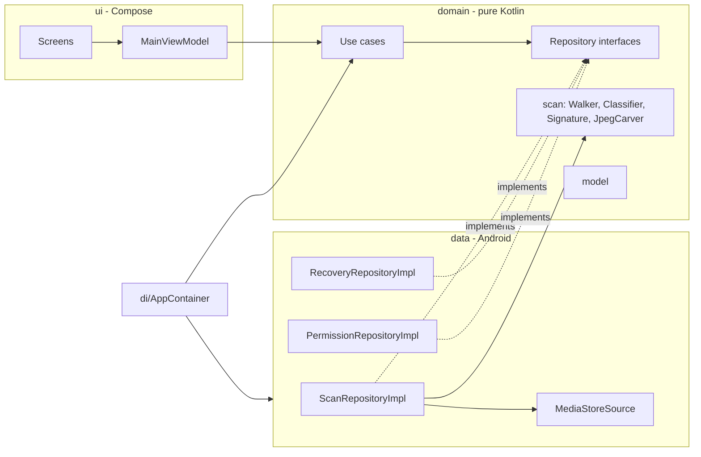

# File Recovery for Android

Find and restore deleted photos, videos and files on a **non-rooted** Android phone.
Native Kotlin + Jetpack Compose, no ads, no network permission, no analytics. Everything stays on the device.

> **Honest scope.** No app can undelete erased disk blocks without root: modern Android encrypts
> internal storage per file and TRIMs freed blocks. What *can* be recovered is data that still exists
> on shared storage but is no longer visible to you. This app finds exactly that, labels each item
> with where it came from, and never claims more.

## Contents

- [What it finds](#what-it-finds)
- [Features](#features)
- [Install](#install)
- [Pull everything to a Mac (no app needed)](#pull-everything-to-a-mac-no-app-needed)
- [Permissions](#permissions)
- [How it works](#how-it-works)
- [Architecture](#architecture)
- [Performance and memory](#performance-and-memory)
- [Build and test](#build-and-test)
- [Limitations](#limitations)
- [FAQ](#faq)
- [Contributing](#contributing)
- [License](#license)

## What it finds

| Source | What it is | Quality | Counted as |
|---|---|---|---|
| **System trash** | MediaStore trash, files named `.trashed-<expiry>-<name>` (Android 11+, kept 30 days). Shows days left. | Original | Deleted |
| **Recycle bin** | Any folder whose name contains `trash`, `recycle`, `dustbin` or `garbage`, plus `LOST.DIR`. Covers Samsung `Android/.Trash`, Huawei `Pictures/.Gallery2/recycle`, Xiaomi `.trashBin` / `.globalTrash`, ColorOS recyclers, ES / CX file managers. | Original | Deleted |
| **Thumbnail** | `Pictures|Movies/.thumbnails/<id>.jpg` whose MediaStore id no longer exists, and JPEGs carved out of legacy `.thumbdata` blobs. | Low resolution | Deleted |
| **Hidden** | Media inside dot-folders, `.nomedia` folders, dot-files, `.pending-*` files (WhatsApp `.Statuses`, sent media, Telegram, app leftovers). | Original | Hidden / cached |
| **App cache** | Extension-less, hash-named images and videos under `Android/` and `cache` folders, identified by magic bytes. | Varies | Hidden / cached |

The home screen never adds the two groups together. "Deleted" is what was really deleted; "hidden or
cached" is media the gallery does not show, which *may* include surviving copies of deleted items.

Normal, visible files are never listed.

## Features

- Parallel scan of all storage volumes, SD card included. A 256 GB phone with ~24,000 candidates scans in a few seconds.
- File type detection by extension first, then by magic bytes for files with no usable name
  (JPEG, PNG, GIF, WebP, BMP, HEIC/AVIF, MP4/MOV/3GP, MKV/WebM, AVI, MP3, M4A, WAV, OGG, FLAC, AMR, PDF, ZIP, RAR, 7z, MS Office).
- Thumbnail grid with image previews and video frames, even for files whose names carry no extension.
- Full-screen preview with pinch zoom, pan, double-tap zoom and swipe between items.
- Sort by size (largest first by default), date or name. Filter by type and by location, including a "Deleted only" filter.
- Multi-select (long-press or tap the circle), select all, running total of the selected size.
- Recovery **copies** files; originals are never moved, renamed or modified. Free space is checked first,
  copies are written to a `.part` file and renamed when complete, so a cancelled recovery leaves no broken files.
- Recovered files go to `RecoveredFiles/Images|Videos|Audio|Documents|Other` with their original names and
  timestamps, and appear in the gallery immediately.
- Material 3, dynamic color, dark mode, RTL support.

## Install

1. Build (see [Build and test](#build-and-test)) or download `app-release.apk` from Releases.
2. Copy the APK to the phone and open it, or run `adb install -r app-release.apk`.
3. Allow **All files access** when asked, then tap **Scan for deleted files**.

Tip: before scanning, also check the places that need no tool at all — your gallery's trash,
Google Photos trash (60 days), Files by Google trash, Samsung My Files trash.

## Pull everything to a Mac (no app needed)

`pull-to-mac.sh` does the same discovery over USB and copies the files straight to the computer.
It is read-only on the phone. Because `adb` may read `Android/data`, it can reach app caches that
apps on Android 11+ cannot.

```bash
./pull-to-mac.sh              # everything: RecoveredFiles + trash, bins, thumbnails, hidden, cache
./pull-to-mac.sh trash        # only system trash and recycle bins (original quality, fastest)
./pull-to-mac.sh recovered    # only the RecoveredFiles folder written by the app
./pull-to-mac.sh all ~/Backup # custom destination (default: ~/Desktop/PhoneRecovery/<date>)
```

Requirements: `adb` (Android platform-tools), USB debugging enabled on the phone, `python3`.
Files are streamed as one tar archive (about 30 s for 2,700 files); anything tar could not read is
pulled individually. Afterwards trashed files get their original names back, dot-folders are
renamed `_name` so Finder shows them, hash-named cache files receive a proper extension and
non-media cache blobs are dropped from the local copy. Works on macOS and Linux.

## Permissions

| Permission | API | Why |
|---|---|---|
| `MANAGE_EXTERNAL_STORAGE` (All files access) | 30+ | Required. Other apps' trashed files and recycle bins are invisible without it. |
| `READ_EXTERNAL_STORAGE`, `WRITE_EXTERNAL_STORAGE` | 26–29 (read up to 32) | The equivalent on Android 8–10. |
| `READ_MEDIA_IMAGES`, `READ_MEDIA_VIDEO` | 33+ | Optional media access. |
| `ACCESS_MEDIA_LOCATION` | 29+ | Optional. Keeps GPS EXIF intact in recovered photos. |

There is **no `INTERNET` permission**. The app cannot send anything anywhere.

`MANAGE_EXTERNAL_STORAGE` is restricted on Google Play to specific app categories; this project is
intended for sideloading.

## How it works

1. **Walk.** Every mounted volume is walked in parallel: one coroutine per directory on a bounded IO
   dispatcher, a single `stat` per entry. Directory flags (`BIN`, `HIDDEN`, `THUMBS`, `LOST`, `CACHE`,
   `ANDROID`) are inherited down the tree, so classifying a file is O(1) with no path parsing.
2. **Classify.** First match wins: trashed name → recycle bin / `LOST.DIR` → thumbnails → hidden → cache.
   Magic bytes are read only when the name does not identify the type, so most files cost no I/O.
3. **MediaStore, concurrently.** The set of live MediaStore ids (to tell orphan thumbnails from live
   ones) and the list of trashed rows are queried while the walk runs. If the id set cannot be
   trusted, the thumbnail category is skipped rather than flagging every thumbnail as deleted.
4. **Carve.** Legacy `.thumbdata` blobs are scanned with a segment-aware JPEG carver. It follows
   segment lengths up to the scan data, so thumbnails embedded in EXIF do not truncate the result.
5. **Publish.** Results are deduplicated by path and published once, largest first.

## Architecture

Clean architecture in a single Gradle module. Dependencies point inward only; `domain` has no
Android imports and is tested on the plain JVM.



```
app/src/main/java/com/eslam/recovery/
├── App.kt, MainActivity.kt
├── di/AppContainer.kt            manual dependency graph (application context only)
├── domain/
│   ├── model/                    RecoverableFile, FileType, Source, Filter, ScanUpdate, RecoveryUpdate
│   ├── scan/                     Walker, DirFlags, Classifier, Signature, TrashedName, JpegCarver
│   ├── repository/               ScanRepository, RecoveryRepository, PermissionRepository
│   └── usecase/                  ScanStorage, RecoverFiles, FilterResults
├── data/
│   ├── scan/                     ScanRepositoryImpl, MediaStoreSource, StorageRoots
│   ├── recovery/                 RecoveryRepositoryImpl, RecoveryDestination
│   ├── permission/               PermissionRepositoryImpl, Permissions
│   ├── coil/                     RecoverableFetcher + Keyer (detected mime → right decoder)
│   └── DispatcherProvider.kt
└── ui/                           MainViewModel, Nav, Permission / Home / Results / Preview screens,
                                  ZoomableImage, RecoveryDialog, Format, theme/
```

Design decisions:

- **Scan and recovery are cold `Flow`s.** Collecting starts the work and cancelling the collector
  stops all of it through structured concurrency. A cancelled scan cannot emit a late progress event.
- **Progress is conflated.** A slow UI skips stale snapshots; the terminal `Finished` event is always delivered.
- **No DI framework.** `AppContainer` is about 30 lines; Hilt would add build time and nothing else here.
- **Coil custom `Fetcher`.** Trashed and recycle-bin files often have no usable extension, and Coil
  chooses the video decoder and EXIF handling by mime type, so the mime detected during the scan is supplied explicitly.

## Performance and memory

- Directory walk parallelism is `cores.coerceIn(4, 8)`; above that the FUSE daemon is the bottleneck.
- Filtering and sorting run on `Dispatchers.Default`; the selection total costs O(selection), not O(results).
- Grid thumbnails are decoded at 256 px, full-screen previews are capped at 2048 px.
- Lazy grids use stable keys and content types. UI updates during a scan are sampled every 200 ms.
- Measured on a Galaxy Z Fold6 (Android 16): ~24,000 results, scan under 5 s, Java heap about 17 MB with the result list loaded.
- Leak safety by construction: the ViewModel holds no `Context`, `View` or `Activity`; repositories and
  the container keep the application context only; all work runs in `viewModelScope`; per-scan state
  lives inside the flow and is released when collection ends.
- Release builds use R8 and resource shrinking: about 1.4 MB APK versus about 19 MB for debug.
  Compose is also markedly faster in release, so use the release APK on a phone.

## Build and test

Requirements: JDK 17, Android SDK with platform 37 (`compileSdk 37`, `targetSdk 36`, `minSdk 26`).
Stack: AGP 9.2.1 with built-in Kotlin 2.2.10, Gradle 9.6.0, Compose BOM 2026.06.00, Coil 3.5.0.

```bash
export JAVA_HOME=$(/usr/libexec/java_home -v 17)   # macOS
echo "sdk.dir=$HOME/Library/Android/sdk" > local.properties

./gradlew :app:testDebugUnitTest   # 35 JVM tests
./gradlew :app:lintDebug
./gradlew :app:assembleRelease     # app/build/outputs/apk/release/app-release.apk
```

The release build type is signed with the local debug keystore so it installs without any secrets.
Replace `signingConfig` before publishing to a store.

Tests cover signature detection, trashed-name parsing, directory flags and classification order,
the JPEG carver (including the embedded-EXIF-thumbnail case), the parallel walker on a temporary
directory tree, filtering and sorting, and the ViewModel (scan, cancel, selection, recovery) with
fake repositories.

## Limitations

- Files erased from trash, or deleted by apps that bypass trash, are gone on a non-rooted phone.
  Only thumbnails or cached copies may remain. A factory reset leaves nothing to recover.
- `Android/data` and `Android/obb` cannot be read by apps on Android 11+. `pull-to-mac.sh` can, through `adb`.
- Some vendors encrypt their gallery trash (reported for Xiaomi). Such files are listed as unknown
  type and can still be copied out, but they will not open.
- Orphan thumbnails are rare on recent Android versions because MediaProvider removes them itself.
- Video preview shows a frame; playback opens in an external player.

## FAQ

**Why does another recovery app show thousands of "deleted photos"?**
Most such apps count every cached or hidden image on the device. This app lists those too, under
"Hidden" and "App cache", but never calls them deleted.

**Is it safe to recover onto the same storage?**
Yes. The sources are ordinary existing files, not free disk blocks, so writing copies cannot overwrite them.

**Does it need root?** No, and it does not use it.

**Does it upload anything?** It cannot: there is no network permission.

## Contributing

Issues and pull requests are welcome. Especially useful: recycle-bin locations of vendors not yet
covered, with the device model and Android version. Please keep `domain/` free of Android imports and
add a unit test for any new classification rule.

## License

[MIT](LICENSE)
